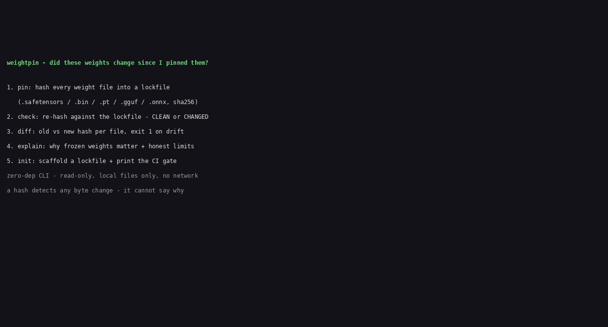

# weightpin

Did these deployed model weights change since I pinned them?

A zero-dependency CLI that pins model weights to a sha256 lockfile and gates CI on byte-level drift. For teams that deploy open-weight models and need to know - not assume - that the bytes on disk are the bytes they approved.

## Why

Governance assumes deployed weights are frozen: eval scores are quoted against a pinned version, guardrails are tested against a fixed checkpoint, change control approves a version string. That assumption broke in November 2026.

arXiv:2611.21885 ("Language Models Can Rewrite Their Own Weights", Jiajun Fan et al., submitted 16/11/2026, v2 18/11/2026, checked 2026-11-21) shows an open 27B model (Qwen3.5-27B) rewriting its own weights by its own reasoning - no gradients, no training - and gaining 6.6 points on problems it never saw (57.2% to 63.8% on 490 held-out problems). It even repairs a damaged copy of itself back to over 80% of the original accuracy on image tasks it never saw.

If a model can rewrite its own weights in production, a version string is not evidence. A hash taken at pin time and re-checked later is. weightpin is that hash, as a one-command CI gate.

## Where rivals beat us

- **Sigstore model-signing** proves *who* published the weights and logs it publicly. weightpin proves nothing about provenance; a lockfile anyone can write is only as trustworthy as the git history and access control around it.
- **huggingface_hub** verifies a download against the authoritative hub copy. weightpin only verifies against your own earlier pin, so if the first pin was already of tampered weights, weightpin will faithfully guard the tampered copy.
- **safetensors** protects the load path (no pickle code execution). weightpin does not inspect tensor contents at all.
- **modeldrift** (our own #24) catches behaviour drift that leaves weights untouched. A behaviour change with identical weights is invisible to weightpin and visible to modeldrift. Bytes and behaviour are different axes; use both.

A hash detects ANY byte change but cannot say WHY it changed or whether it is benign - that judgement stays human. See `weightpin explain limits`.

## Install

Install from source only. npm publish is pending an owner token decision.

```sh
git clone https://github.com/techdevfun/weightpin.git
cd weightpin
npm install
npm run build
```

Requires Node 20 or newer. Zero runtime dependencies.

## Demo



The GIF is rendered from a real transcript (`demo/transcript.txt`): pin the real live-model safetensors file, check CLEAN, tamper a copy, check CHANGED, diff, explain limits, init.

## Quickstart

```sh
# Pin the weights you deploy
weightpin pin ./models/qwen --lockfile weightpin.lock.json
git add weightpin.lock.json && git commit -m "Pin model weights"

# Check on every deploy and on a schedule
weightpin check ./models/qwen --lockfile weightpin.lock.json
# exit 0 when clean, 1 on any drift, 2 on a usage error

# See exactly what changed
weightpin diff ./models/qwen --lockfile weightpin.lock.json

# Learn why frozen weights matter, and the honest limits
weightpin explain self-rewriting
weightpin explain limits

# Scaffold a lockfile and print the CI gate snippet
weightpin init ./models/qwen
```

## Working example

Pin the real tiny model shipped in this repo (a real GPT-2 safetensors file from Hugging Face, `examples/live-model/`, sha256 recorded in its README):

```sh
weightpin pin examples/live-model --lockfile /tmp/demo.lock.json
# pinned 1 weight file(s), 453864 bytes
# lockfile: /tmp/demo.lock.json
#   model.safetensors  8111d5afb071  453864

weightpin check examples/live-model --lockfile /tmp/demo.lock.json
# verdict: CLEAN
# summary: 1 unchanged, 0 changed, 0 missing, 0 new

# Flip one byte in a copy and check again:
cp -r examples/live-model /tmp/model-tampered
python3 -c "p='/tmp/model-tampered/model.safetensors'; d=bytearray(open(p,'rb').read()); d[-1]^=0xff; open(p,'wb').write(d)"
weightpin pin /tmp/model-tampered --lockfile /tmp/tampered.lock.json >/dev/null
weightpin check /tmp/model-tampered --lockfile /tmp/demo.lock.json
# verdict: CHANGED
#   CHANGED model.safetensors  8111d5afb071 -> <new hash>  453864 -> 453864
```

## Commands

| Command | What it does | Exit codes |
|---|---|---|
| `pin <model-dir> [--lockfile <path>] [--json]` | Hash every weight file, write the lockfile (default `./weightpin.lock.json`) | 0 ok, 2 usage error |
| `check <model-dir> [--lockfile <path>] [--json]` | Re-hash and compare; verdicts CLEAN / CHANGED / MISSING / NEW | 0 clean, 1 drift, 2 usage error |
| `diff <model-dir> [--lockfile <path>] [--json]` | Per-file table: old vs new sha256 (12 chars) and sizes | 0 clean, 1 drift, 2 usage error |
| `explain [topic]` | `frozen`, `self-rewriting`, `limits`, `ci`, `lockfile` | 0 ok, 2 unknown topic |
| `init [model-dir] [--lockfile <path>]` | Pin if weights exist, else write an empty scaffold; print the CI gate | 0 ok, 2 usage error |

Weight files (case-insensitive, recursive, sorted): `.safetensors`, `.bin`, `.pt`, `.pth`, `.gguf`, `.onnx`. Config, tokenizer and documentation files are ignored. Symlinks are skipped, never followed. Hidden files and directories are skipped.

Verdict precedence when several problems coexist: CHANGED, then MISSING, then NEW. A `check` on a dir with no weight files and an empty lockfile is CLEAN.

## Verdict rules

- **CLEAN** - every pinned file hashes identically, nothing missing, nothing new.
- **CHANGED** - at least one pinned file has a different hash or size.
- **MISSING** - at least one pinned file is gone from the model dir.
- **NEW** - at least one weight file on disk is not in the lockfile.

## The lockfile

`weightpin.lock.json` is JSON you commit to git: per weight file the relative path, full sha256 and byte size, plus pin time (UTC), tool version and totals. Files are sorted by path. The lockfile itself is never hashed, so pinning twice produces the same lockfile except for `pinnedAt`.

## CI flow

```yaml
- name: Check deployed weights are unchanged
  run: weightpin check ./models/qwen --lockfile weightpin.lock.json
```

The check exits 1 on any drift, so it fails the build. When drift is real and approved, re-pin and commit the new lockfile in the same change that approves the new weights. Never re-pin silently to make a red build green.

## Honest limits

- A hash detects any byte change. It cannot say why weights changed or whether the change is benign. That judgement stays human.
- Pin from a known-good source and record the provenance. If the first pin was of tampered weights, weightpin guards the tampered copy.
- Weights changed only in memory and never written to disk are invisible to a file hash.
- The lockfile is only as trustworthy as its storage: commit it to git, protect it with review and branch protection, and treat a lockfile change as a change that needs review.
- weightpin proves nothing about provenance (use Sigstore model-signing for that) and nothing about behaviour (use modeldrift for that).

## Roadmap

- `--include` for extra weight extensions (`.ckpt`, `.h5`, `.msgpack`).
- Progress output for very large model dirs.
- A runtime hook for in-memory-only weight changes (out of scope for file hashing).
- npm publish (`weightpin` is unclaimed as of 2026-11-21; pending an owner token decision).

## License

MIT. See [LICENSE](LICENSE).
